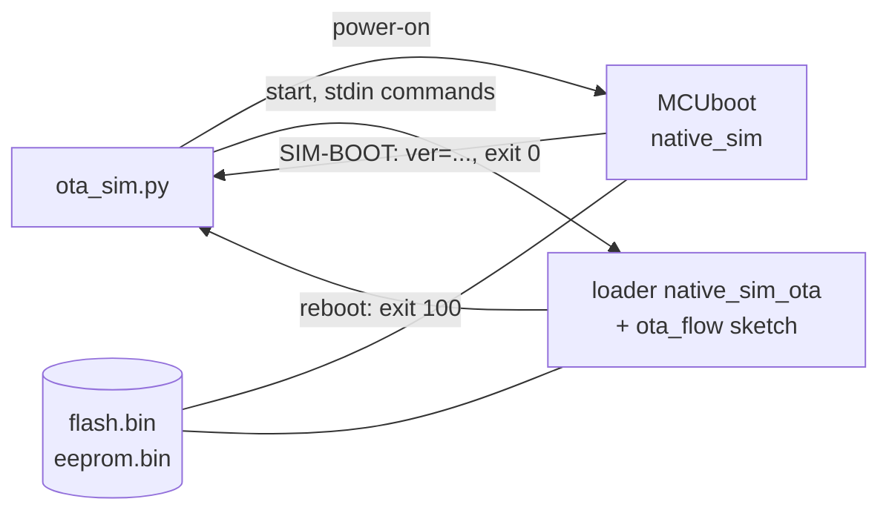

# MCUboot OTA simulator

Runs the MCUboot OTA flow of the Nano XL Link on the host: MCUboot with the
update policy of `loader/mcuboot_hooks`, then the loader with the MCUboot OTA
backend (`loader/ota/ota_mcuboot.c`) and a sketch, on a simulated flash.
Unlike `loader/mcuboot_hooks/sim` (bootutil alone, in the MCUboot Rust
simulator), the loader, the OTA library and the trial window run too.



- MCUboot and the loader are two native_sim executables sharing the flash
  (`--flash`) and the EEPROM (`--eeprom`) files. A "reboot" is the end of one
  process and the start of the next.
- `mcuboot_sim_boot.c`: MCUboot prints its boot decision and exits instead of
  jumping (`boot_image_jump_hook()`); exit code 3 means no bootable image.
- `mcuboot_sim_loader.c`: `sys_arch_reboot()` is wrapped at link time to end
  the loader with exit code 100 (native_sim would re-execute the loader).
  It also starts the counter watchdog, as MCUboot does on the board.
- `retained_mem_eeprom.c`: retained memory in the simulated EEPROM, for the
  boot mode and MCUboot's bootloader info, at the Nano XL Link offsets.
- `ota_sim.overlay`: swap-using-offset layout (slot1 one sector larger),
  8-byte writes, retention areas and the counter watchdog, for both images.
- `mcuboot.conf`, `loader.conf`: the Nano XL Link configuration without USB.
  The loader is the `native_sim_ota` board (`-DARDUINO_OTA_SIM=y`).

## Running

```sh
./extra/build.sh native_sim_ota
loader/native_sim/ota_sim/tests/run_tests.sh [-w <work dir>] [<scenario>...]
```

`-w` keeps the flash, EEPROM and log of each scenario. The loader runs with
`--no-rt`: the 60 s trial window takes milliseconds.

## Scenarios (`tests/ota_sim.py`)

Each starts from v1 programmed over SWD (no trailer).

| Scenario | Checks |
|---|---|
| `confirmed` | O1: OTA, swap as a test, `ota_confirm()`, no revert |
| `not_confirmed` | O2: no confirm, reboot after 60 s, revert |
| `feed_watchdog` | `ota_feed_watchdog()` keeps a 90 s trial alive; without it, revert |
| `update_while_testing` | `ota_write_begin()` refuses an update before the confirm (-EBUSY) |
| `bad_signature`, `bad_hash` | O4: MCUboot rejects the image, v1 stays |
| `truncated` | `ota_loader_ready()` refuses an image cut in its payload |
| `truncated_tlv` | an image cut in its TLVs is staged, MCUboot rejects it |
| `permanent` | a permanent request (USB DFU) overwrites slot0 for good |

The sketch (`tests/ota_flow`) runs line commands from stdin. The Serial RX
buffer drops the bytes that do not fit, so images are sent in 512-byte chunks,
each acknowledged by the sketch.

## Not simulated

USB (loader DFU, MCUboot DFU, double tap), the 1200-bps touch, and a hung
sketch: a busy loop does not advance the simulated time, so the watchdog
never bites.
